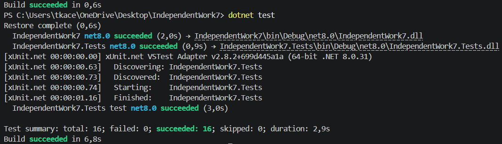

# Звіт із самостійної роботи №13

**З дисципліни:** Об'єктно-орієнтоване програмування
**Тема:** Узагальнений кеш `Cache<TKey, TValue>` із тестами
**Виконав:** студент Ткаченко Максим

---

## 1. Мета роботи

Розробити узагальнений клас кешу, який зберігає дані за ключем та має політику видалення найстаріших елементів (FIFO — First In, First Out), а також написати юніт-тести для перевірки його функціональності.

## 2. Завдання

- Створити консольний проєкт `IndependentWork7`.
- Створити проєкт тестів `IndependentWork7.Tests` із посиланням на основний проєкт.
- Реалізувати `Cache<TKey, TValue>` з обмеженою ємністю та політикою FIFO.
- Написати юніт-тести для всіх публічних членів класу.
- Продемонструвати роботу в методі `Main` (`Cache<string, string>` та `Cache<int, MyObject>`).

## 3. Структура проєкту

- `IndependentWork7/Cache.cs` — узагальнений FIFO-кеш.
  - `_capacity` — максимальна кількість елементів;
  - `_cache` (`Dictionary<TKey, TValue>`) — зберігання ключів і значень;
  - `_keysOrder` (`Queue<TKey>`) — порядок додавання ключів.
  - Публічні члени: конструктор `Cache(int capacity)`, `Add`, `Get`, `ContainsKey`, `Count`.
- `IndependentWork7/Program.cs` — демонстрація роботи кешу.
- `IndependentWork7.Tests/CacheTests.cs` — юніт-тести (xUnit).
- `IndependentWork7.sln` — рішення, що об'єднує обидва проєкти.
- `.gitignore` — виключає службові файли .NET, VS Code та ОС.

## 4. Реалізація

- **Add** — якщо ключ уже є, значення оновлюється (порядок у черзі не змінюється). Якщо кеш повний, `Dequeue()` повертає найстарший ключ, який видаляється зі словника. Потім новий ключ додається до словника і черги.
- **Get** — використовує `TryGetValue`, а не індексатор, щоб самостійно кинути `KeyNotFoundException` з зрозумілим повідомленням.
- **ContainsKey / Count** — делегують словнику.
- Конструктор кидає `ArgumentOutOfRangeException`, якщо ємність ≤ 0.
- Обмеження `where TKey : notnull` гарантує коректність ключів у словнику.

## 5. Тести

| Що перевіряється | Тести |
|------------------|-------|
| Конструктор | ємність 0 і від'ємна кидають виняток; новий кеш порожній |
| Додавання | один елемент, кілька елементів, оновлення наявного ключа |
| Отримання | існуючий ключ повертає значення; відсутній ключ → `KeyNotFoundException` |
| Переповнення | видалення найстарішого; `Count` ≤ ємності; `Get` видаленого ключа кидає виняток; порядок видалення відповідає порядку додавання |
| Політика FIFO | `Get` не змінює порядок видалення (відмінність від LRU); оновлення ключа в повному кеші нічого не видаляє |
| `ContainsKey`, `Count` | відсутній ключ, зміна лічильника |

Запуск:

```bash
dotnet test
dotnet run --project IndependentWork7
```

### Результати виконання


```
Build succeeded in 0,6s
PS C:\Users\tkace\OneDrive\Desktop\Independentwork7> dotnet test
Restore complete (0,6s)
Independentwork7 net8.0 succeeded (2,0s) → Independentwork7\bin\Debug\net8.0\IndependentWork7.dll
IndependentWork7.Tests net8.0 succeeded (0,9s) → IndependentWork7.Tests\bin\Debug\net8.0\Independentwork7.Tests.dll
[xUnit.net 00:00:00.00] xUnit.net VSTest Adapter v2.8.2+699d445a1a (64-bit .NET 8.0.31)
[xUnit.net 00:00:00.63] Discovering: IndependentWork7.Tests
[xUnit.net 00:00:00.73] Discovered: IndependentWork7.Tests
[xUnit.net 00:00:00.74] Starting: Independentwork7.Tests
Finished: Independentwork7.Tests [xUnit.net 00:00:01.16]
Independentwork7.Tests test net8.0 succeeded (3,0s)
Test summary: total: 16; failed: 0; succeeded: 16; skipped: 0; duration: 2,9s
Build succeeded in 6,8s
```

### Скріншот


## 6. Висновок

Реалізовано узагальнений кеш із політикою FIFO на основі `Dictionary<TKey, TValue>` та `Queue<TKey>`. Словник забезпечує доступ за ключем за O(1), а черга зберігає порядок додавання, тож видалення найстарішого елемента також виконується за O(1). Окремі тести для кожного публічного методу полегшують пошук помилок, якщо `Add` або `Get` після переповнення поводяться некоректно. Для кращої ефективності використання кешу політику можна розширити до LRU (через `LinkedList<TKey>`).

## 7. Відповіді на контрольні питання

1. **Переваги `Cache<TKey, TValue>`.** Один клас працює з будь-якими типами ключів і значень, без дублювання коду. Є типобезпека на етапі компіляції, немає боксингу/приведення типів, як у неузагальнених колекціях з `object`.
2. **Для чого `Queue` / порядок ключів.** `Dictionary` не гарантує порядок елементів, тому для визначення «найстарішого» потрібна окрема структура. Черга додає ключі в кінець, а `Dequeue()` повертає найстаріший за O(1).
3. **`KeyNotFoundException` чи `TryGetValue`.** `Get` повинен кидати виняток, коли за контрактом ключ має бути в кеші, а його відсутність — помилка. `TryGetValue` доцільніший, коли відсутність ключа — штатна ситуація (наприклад, «промах кешу» з подальшим обчисленням значення), бо він дешевший за виняток.
4. **Критично важливі тести.** Видалення саме найстарішого елемента при переповненні; `Count` ніколи не перевищує ємність; `Get` видаленого ключа кидає `KeyNotFoundException`; порядок видалення збігається з порядком додавання; `Get` не змінює порядок (FIFO ≠ LRU); оновлення наявного ключа в повному кеші нічого не видаляє.
